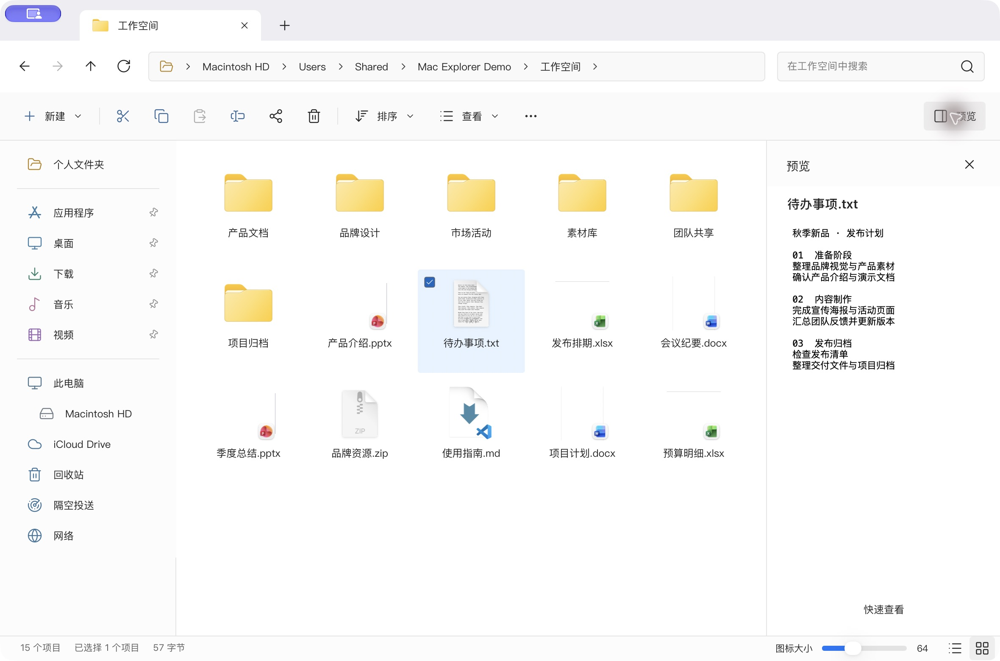

<div align="center">
  
  <h1>Mac Explorer</h1>
  <p><strong>熟悉的 Windows 文件管理方式，原生的 Mac 应用。</strong></p>
  <p>A native macOS file manager with Windows Explorer workflows.</p>
  <p>
    <a href="https://github.com/qixiaoyu27/Mac-Explorer/releases/latest">下载最新版本</a> ·
    <a href="#下载与安装">安装与升级</a> ·
    <a href="https://github.com/qixiaoyu27/Mac-Explorer/issues">反馈问题</a>
  </p>
</div>



Mac Explorer 面向习惯 Windows 文件资源管理器的 Mac 用户，提供多标签、路径栏、导航树、文件操作、压缩包浏览和 Git / SVN 集成。应用直接管理本机文件，与 Finder 共存，不替换 Finder。

## 下载与安装

适用环境：**Apple Silicon（M 系列）· macOS 13 及以上**。

### 一键安装或升级

先退出 Mac Explorer，在终端执行：

```sh
/bin/bash -c "$(curl -fsSL https://raw.githubusercontent.com/qixiaoyu27/Mac-Explorer/refs/tags/v1.1.0/scripts/install.sh)"
```

默认安装到 `/Applications/Mac Explorer.app`，不需要 npm、Homebrew 或 `sudo`。此命令固定安装脚本版本，应用包从最新正式 Release 下载。

安装器会校验 SHA-256、应用标识、Apple Silicon 架构和签名，再替换应用；不会覆盖不同标识的其他应用，不会降级较新的本地版本。下载或校验失败保留原应用，替换失败尝试恢复原应用。

**旧版升级：** 同一命令支持从官方 Electron 版升级到原生版。若系统应用目录尚无安装，但旧版位于 `~/Applications/Mac Explorer.app`，会将其升级至系统应用目录。原生版使用独立偏好设置；旧版配置文件保留，但外观、自定义快捷键、窗口会话等不会自动导入，需要在原生版重新设置。快速访问可通过「设置 → 常规 → 从 Finder 导入收藏夹」重新导入。个人文件不会因安装或升级被修改。

历史版本中固定到旧 tag 的安装命令及 Electron 应用内更新器不会自动切换原生安装协议。**跨架构升级请使用上面的新命令，或手动安装 DMG。** 已有原生版可继续使用「设置 → 关于」中的检查、下载和重启安装。

### 首次打开与系统安全提示

应用和 DMG 使用 **ad-hoc 临时签名，未经 Apple 公证**。如果系统拦截，可在「系统设置 → 隐私与安全性」中确认允许打开。默认安装命令不会关闭 Gatekeeper，也不会移除下载隔离标记。

如果你信任本项目，并明确同意仅移除本次安装应用的下载隔离标记，可使用：

```sh
MAC_EXPLORER_ALLOW_UNNOTARIZED=1 /bin/bash -c "$(curl -fsSL https://raw.githubusercontent.com/qixiaoyu27/Mac-Explorer/refs/tags/v1.1.0/scripts/install.sh)"
```

该选项仍执行签名和校验检查，不代表 Apple 公证；如果系统提示恶意软件，请不要继续运行。

### 手动安装与校验

1. 打开 [GitHub Releases](https://github.com/qixiaoyu27/Mac-Explorer/releases/latest)，下载 `Mac-Explorer-Native-版本号-mac-arm64.dmg`。
2. 退出旧应用，打开 DMG，将 **Mac Explorer** 拖入 **Applications**，按系统提示替换。
3. 启动应用，按需授予桌面、文稿或下载文件夹的访问权限。

附件同时提供 ZIP、`SHA256SUMS-native.txt` 和安装脚本。将 ZIP、DMG 与校验文件下载到同一目录后执行：

```sh
shasum -a 256 -c SHA256SUMS-native.txt
```

需要安装到其他可写目录时，可在一键安装命令前设置 `MAC_EXPLORER_INSTALL_DIR=/完整路径`。原有 `MAC_EXPLORER_NO_OPEN=1` 参数仍可用于安装后不自动启动。

## 日常文件管理

- **多标签与导航：** 独立前进/后退历史、面包屑与地址编辑、目录树、标签拖出独立窗口、会话恢复。
- **八种布局：** 超大、大、中、小图标，以及列表、详细信息、平铺、内容；支持排序、隐藏项目、扩展名、紧凑视图和选择复选框。
- **清晰的选择状态：** 已选项目的复选框常显，未选项目悬停时显示；桌面、文稿、下载、音乐等特殊目录具有对应图标。
- **文件操作：** 新建文件夹、文本及 Office 模板，复制、剪切、粘贴、移动、重命名、拖放、撤销和系统回收站。
- **搜索：** 按名称递归搜索，支持普通文本、通配符和正则表达式；跳过符号链接与应用包内部，并限制搜索规模。
- **预览与属性：** Quick Look、预览/详细信息窗格、文本和图片预览，以及大小、占用空间、日期、文件数量等属性。
- **打开方式：** 使用系统默认应用，选择其他可用应用，或用文本编辑打开文件；重复应用合并显示。

## 快速访问与系统位置

快速访问支持固定、取消固定和拖动排序，并在窗口间同步。Finder 收藏夹导入只读取并合并条目，不修改 Finder 配置。此电脑显示实际挂载卷、容量及 iCloud Drive；网络页面提供 SMB 地址连接、Bonjour 发现及名称/地址筛选。AirDrop 使用 macOS 共享能力。

## 压缩包与版本控制

压缩包支持内部目录浏览、选择文件、临时打开、解压到指定位置及创建 ZIP。解压拒绝路径越界、危险链接和覆盖已有目标。

Git / SVN 集成提供状态角标、差异、暂存/添加、提交、更新及丢弃操作。写入前展示操作内容，拒绝过期的操作计划，丢弃前备份；可在设置中关闭检测。

## 设置与快捷键

通过「更多 → 设置」或 **⌘,** 打开设置：

- **常规：** 浅色、深色、跟随系统；简体中文、繁体中文、英文；快速访问、可选系统文件查看器、版本控制和默认文件夹视图。
- **自定义工具栏：** 选择常用操作并调整顺序。
- **键盘快捷键：** 自定义操作键及全局唤醒键，保存前检测冲突；清除唤醒键后需保存才生效。
- **关于：** 项目信息、手动检查更新，以及启动时、每天、每周或从不自动检查更新。

每个文件夹可分别记忆布局与排序，未覆盖的项目跟随全局默认设置。设置变化会同步到其他窗口。

| 操作 | 默认快捷键 |
| --- | --- |
| 复制 / 剪切 / 粘贴 | ⌘C / ⌘X / ⌘V |
| 移动已复制项目到这里 | ⌥⌘V |
| 创建副本 / 全选 | ⌘D / ⌘A |
| 新建文件夹 / 移到回收站 | ⇧⌘N / ⌘⌫ |
| 重命名 / 快速查看 | Return 或 F2 / Space |
| 前往文件夹 / 搜索 | ⇧⌘G / ⌘F |
| 后退 / 前进 / 上一级 | ⌘[ / ⌘] / ⌘↑ |
| 新建 / 关闭标签页 | ⌘T / ⌘W |
| 第 1–8 个 / 最后一个标签页 | ⌘1–8 / ⌘9 |
| 切换八种布局 | ⌃⇧1–8 |
| 预览窗格 / 详细信息窗格 | ⇧⌘P / ⌘I |

实际绑定以设置及菜单显示为准；输入框中的文本编辑快捷键保留原有语义。

## 文件安全

复制、移动、新建和解压不会静默覆盖重名目标；普通删除进入系统回收站，清空回收站需另行确认。部分失败会显示错误，撤销前检查目标身份，避免操作已被外部替换的文件。

系统权限仍由 macOS 管理。可选文件查看器接入仅处理部分“在文件夹中显示”请求，需要用户主动启用，并可恢复；不会完全替代 Finder。

网络断线、跨卷操作及外部程序同时修改文件可能导致部分完成。

## 从源码构建

需要 macOS、Apple Silicon 和 Xcode Command Line Tools。原生开发不需要 npm。

```sh
git clone https://github.com/qixiaoyu27/Mac-Explorer.git
cd Mac-Explorer
python3 -I native/scripts/build.py
open 'native/output/Mac Explorer.app'
```

开发检查：

```sh
python3 -I native/scripts/check-core.py
python3 -I native/scripts/check-archives.py
python3 -I native/scripts/check-vcs.py
python3 -I native/scripts/check-native-install.py
python3 -I native/scripts/check-localization.py
python3 -I native/scripts/smoke.py --validation
```

窗口检查会打开独立验收应用；文件操作使用临时夹具。生成目录 `native/output/`、`native/.build/` 不提交。更多架构和文件安全说明见 [native/README.md](native/README.md)。

## 版本策略

采用 SemVer：兼容修复更新 PATCH，兼容功能更新 MINOR，不兼容变更更新 MAJOR。版本号仅在正式发布到 GitHub 时更新，日常开发、测试和本地构建不递增；已发布版本、tag 和附件不覆盖。

## 参与贡献

欢迎提交 [Issue](https://github.com/qixiaoyu27/Mac-Explorer/issues) 或 Pull Request。请说明复现步骤、macOS 版本和应用版本；文件操作问题请使用可分享的测试文件，勿上传私人数据。开发与发布约定见 [AGENTS.md](AGENTS.md)。

## 许可证与致谢

项目采用 [GPL-3.0](LICENSE)。界面图标包含 Lucide artwork，其 ISC 许可见 [native/ICON-LICENSE.txt](native/ICON-LICENSE.txt)。感谢代码、测试和问题反馈的贡献者；具体贡献在各版本发布说明中署名。
