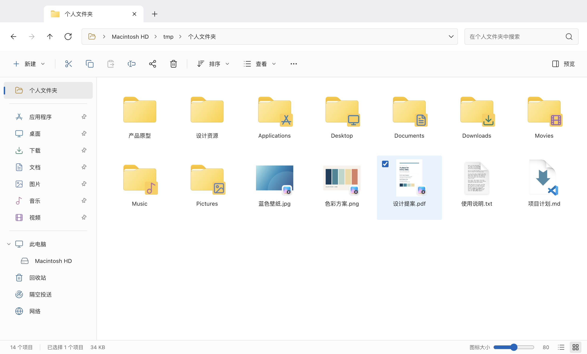

<div align="center">
  
  <h1>Mac Explorer</h1>
  <h3>熟悉的操作，Mac 的体验。</h3>
  <p>一款原生 macOS 文件管理器，让熟悉的 Windows 文件管理习惯，在 Mac 上继续。<br>从工作文档到生活照片，为每天与文件打交道的你而做。</p>
  <p>
    <a href="#下载与安装"><strong>一键安装</strong></a> &nbsp;·&nbsp;
    <a href="#日常所需触手可及">功能一览</a> &nbsp;·&nbsp;
    <a href="https://github.com/qixiaoyu27/Mac-Explorer/releases">更新记录</a>
  </p>
  <p><sub>macOS 13 及以上 · Apple Silicon（M 系列）· 免费开源</sub></p>
</div>

<br>



<p align="center"><sub>图示为早期版本，当前版本界面以实际应用为准。</sub></p>

换到 Mac，有很多值得喜欢的新体验，也有一些早已顺手的习惯：沿着目录树找文件，复制一段路径直达目的地，在几个文件夹之间剪切、粘贴。Mac Explorer 希望把这些习惯接续下来，让你把注意力留给手头的事情。

无论是整理一周的下载、挑选旅行照片，还是在多个项目之间切换，你都可以用熟悉的方式开始，再慢慢把视图、工具栏和快捷键调整成自己的样子。

## 下载与安装

**使用 Homebrew，一条命令安装。**

已安装 [Homebrew](https://brew.sh/)？打开「终端」，执行：

```sh
brew install --cask qixiaoyu27/tap/mac-explorer
```

通过我们维护的 Tap 下载正式版，校验后安装到「应用程序」。

**还没有 Homebrew？** 先执行 [Homebrew 官方安装命令](https://brew.sh/)：

```sh
/bin/bash -c "$(curl -fsSL https://raw.githubusercontent.com/Homebrew/install/HEAD/install.sh)"
```

完成后按终端中的「Next steps」提示配置环境，再运行上方 Mac Explorer 安装命令。也可以直接 [下载 DMG](https://github.com/qixiaoyu27/Mac-Explorer/releases/latest)。

<sub>应用支持 macOS 13 及以上 · Apple Silicon（M 系列）；Homebrew 自身的系统要求以其官网为准。</sub>

> **首次打开**
> 当前版本尚未经过 Apple 公证。若 macOS 阻止打开，请确认下载来源为本仓库，再到「系统设置 → 隐私与安全性」允许打开。若系统明确提示恶意软件，请勿继续运行。

**已经通过 DMG 或旧脚本安装过？** 如果 `brew install` 提示应用已存在，先确认现有应用是当前正式版，再让 Homebrew 接管：

```sh
brew install --cask --adopt qixiaoyu27/tap/mac-explorer
```

接管会保留应用文件和偏好设置，只补齐 Homebrew 安装记录；旧版本请先通过应用内更新或 DMG 升级。接管成功后才能使用下面的更新命令，详情见 [迁移说明](https://github.com/qixiaoyu27/homebrew-tap#安装)。

**后续更新：** 退出应用后执行以下命令，也可以在「设置 → 关于」中检查更新。

```sh
brew update && brew upgrade --cask --greedy qixiaoyu27/tap/mac-explorer
```

卸载方法见 [Homebrew 安装指南](https://github.com/qixiaoyu27/homebrew-tap#readme)。

<details>
<summary>也可以手动安装 DMG</summary>

1. 前往 [下载页面](https://github.com/qixiaoyu27/Mac-Explorer/releases/latest)，选择 **DMG** 安装包。
2. 打开 DMG，将 **Mac Explorer** 拖入 **Applications（应用程序）**。更新时请先退出旧版本。
3. 打开应用，按需允许访问桌面、文稿或下载文件夹。

</details>

<details>
<summary>从早期版本升级</summary>

从早期 Electron 版升级时，请退出旧应用并手动安装 DMG；如需转用 Homebrew，请按上方迁移说明操作。旧版应用内更新器无法自动完成此次迁移。

个人文件不受影响。外观、快捷键和窗口会话等偏好需要重新设置；收藏夹可通过「设置 → 常规 → 从 Finder 导入收藏夹」重新导入。

</details>

## 日常所需，触手可及

文件管理贯穿一天里许多细小的时刻。找到刚下载的附件，确认一份文档，把整理好的资料交给同事——这些小事，值得一套顺手的工具。

<table>
  <tr>
    <td width="50%" valign="top">
      <h3>浏览，有条不紊</h3>
      <p>资料在下载目录，成品在项目文件夹，参考内容又放在另一处。用多个标签页保留各自的位置，沿目录树浏览，或输入路径直达目的地。</p>
      <p>把常用文件夹固定到快速访问，也能导入 Finder 收藏夹，让熟悉的位置随手可达。</p>
    </td>
    <td width="50%" valign="top">
      <h3>查看，恰到好处</h3>
      <p>挑照片时看大图标，整理文档时看名称、日期和大小。八种视图适应不同内容，每个文件夹记住自己的布局与排序。</p>
      <p>不确定是不是要找的文件？按下空格快速预览，看过之后再决定。</p>
    </td>
  </tr>
  <tr>
    <td width="50%" valign="top">
      <h3>整理，顺手完成</h3>
      <p>把零散的下载归档，为文档改个清楚的名字，将准备好的资料打包。剪切、粘贴、拖放、重命名与撤销，延续熟悉的操作顺序。</p>
      <p>收到压缩包时，先浏览内容再决定解压；需要分享时，也可以直接创建 ZIP。</p>
    </td>
    <td width="50%" valign="top">
      <h3>习惯，由你定义</h3>
      <p>喜欢明亮清晰，或习惯深色环境，都可以选择，也可以跟随系统。简体中文、繁体中文与英文，让界面用你熟悉的语言表达。</p>
      <p>将常用操作留在工具栏，把快捷键调成顺手的组合，让工具配合你的节奏。</p>
    </td>
  </tr>
  <tr>
    <td width="50%" valign="top">
      <h3>不同位置，一处浏览</h3>
      <p>本机文稿、iCloud Drive、外接磁盘和网络共享，各有各的用途。用熟悉的导航方式访问这些位置，减少来回寻找入口。</p>
      <p>从个人资料到共享文件夹，让日常整理有一个清晰的起点。</p>
    </td>
    <td width="50%" valign="top">
      <h3>项目细节，随时查看</h3>
      <p>处理代码项目时，通过 Git / SVN 集成查看文件状态与差异，按需完成版本管理操作。</p>
      <p>不需要这些功能时，可以关闭检测，将注意力留给眼前的文件。</p>
    </td>
  </tr>
</table>

<br>

## 熟悉，也尊重你的选择

### 和 Finder 一起，各得其所

你可以继续使用 Finder，也可以在需要目录树、多标签或熟悉的剪切粘贴流程时打开 Mac Explorer。它们可以共存，不必一次改变所有习惯。文件夹访问权限仍由 macOS 管理，系统集成功能由你主动开启。

### 认真对待每一次整理

文件里装着工作成果，也可能是只拍过一次的照片。普通删除会进入系统回收站；复制、移动与解压遇到重名文件时，不会静默覆盖。处理文件时，让结果清楚、让必要的确认被看见，是我们看重的基本体验。

### 免费开源，一起慢慢打磨

你可以自由使用，也可以查看源代码、提出改进或参与开发。一处不顺手的交互、一条不够清楚的提示，都值得被认真讨论。我们希望在这些具体的小事里，让 Mac Explorer 越来越好用。

<details>
<summary>常用快捷键</summary>

| 操作 | 快捷键 |
| --- | --- |
| 复制 / 剪切 / 粘贴 | ⌘C / ⌘X / ⌘V |
| 新建标签页 | ⌘T |
| 前往文件夹 | ⇧⌘G |
| 搜索 | ⌘F |
| 重命名 | Return 或 F2 |
| 快速查看 | Space |
| 移到回收站 | ⌘⌫ |
| 打开设置 | ⌘, |

更多操作与自定义选项可在应用菜单和设置中查看。

</details>

## 反馈与参与

如果某一步让你停下来想了想，或某个熟悉的操作还不够顺手，欢迎 [告诉我们](https://github.com/qixiaoyu27/Mac-Explorer/issues)。描述你当时想做什么、遇到了什么，会帮助我们理解问题；报告故障时，请附上应用与 macOS 版本、复现步骤，并隐去私人信息。

也欢迎参与代码、测试和文档改进，相关说明见 [开发文档](native/README.md) 与 [贡献约定](AGENTS.md)。感谢每一位愿意花时间试用、反馈和贡献的人，让这个项目一点点变得更完善。

<details>
<summary>版本策略</summary>

<a id="版本策略"></a>

采用 SemVer：兼容修复更新 PATCH，兼容功能更新 MINOR，不兼容变更更新 MAJOR。版本号仅在正式发布到 GitHub 时更新，日常开发、测试和本地构建不递增；已发布版本、tag 和附件不覆盖。

</details>

---

[GPL-3.0 开源许可](LICENSE) · 界面图标包含 [Lucide artwork（ISC）](native/ICON-LICENSE.txt)
