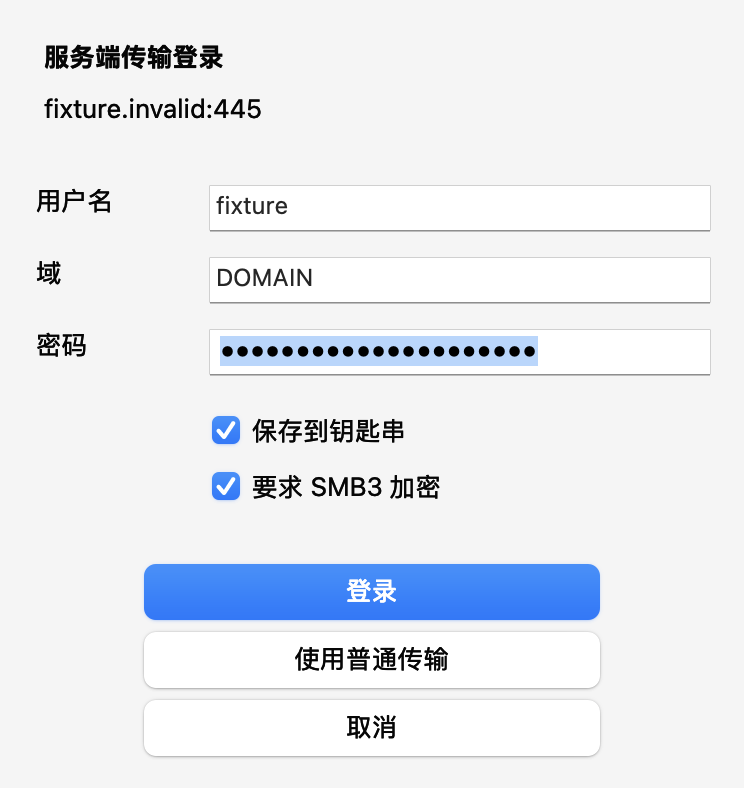
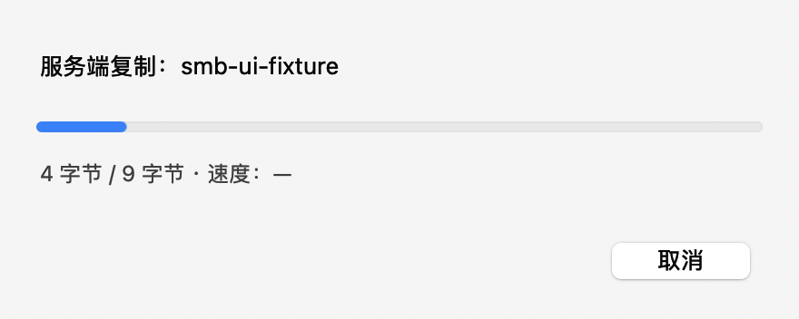

# 同服务器跨共享传输

独立 SMB2/3 客户端为同一服务器的不同已挂载共享提供服务端主数据复制。复制、移动均沿用 Mac Explorer 的进度、取消、错误决策、日期恢复、提交和删源流程。设置 → 常规 → 网络传输可关闭优化；默认开启。移动仍为复制、复核、删源。

## 界面夹具

以下为 AppKit 自动化生成的界面夹具，不是真实 NAS 传输截图。登录图使用虚构账号和预填的测试凭据；首次登录默认不保存密码。





## 调用链与依赖

`BrowserController → NativeTransferPanel → FileActions → VerifiedTransfer → NativeSMBDataCopier → SMBTransport → libsmb2`。

- `SMBMountedLocation` 解析挂载来源。只有 smbfs、同一主机/端口/挂载账号、不同共享且实际数值端点一致时才尝试优化。不推断主机别名、DFS 或子目录挂载。
- `ServerSideCopyProvider` 是单次操作的数据接口。目录、空文件和符号链接使用原有路径；目录可混合两种复制方式。
- libsmb2 固定提交 `57fea04fd29403e3978000179339c8e13ce46b5c`，源码随仓库构建，无 Homebrew 运行时依赖。原始文件与上游固定提交逐文件核对通过。许可证、COPYING 和重建说明随应用提供，详见 [依赖说明](../native/Vendor/libsmb2/README.mac-explorer.md)。
- 独立会话要求签名，默认要求 SMB3 加密；不复用或提取系统挂载密码。首次独立登录可以选择仅本次应用会话保存，或认证成功后保存到专用钥匙串服务。验证版使用独立 Bundle ID；清除凭据只作用于本应用专用服务。

## 数据和安全边界

使用同一 SMB 会话的两个 tree connect，申请来源 ResumeKey，再逐次发送最多 1 MiB 的 COPYCHUNK。服务端通告更小限制时有界调整请求。只有服务端确认的字节计入完成进度，不使用应用层内容哈希或第二次全文件读取。

目标由原流程排他创建。远端只 FILE_OPEN 已存在对象，不创建、覆盖或截断路径；远端祖先和条目句柄限制删除/替换，来源限制并发写入，再与本地持有描述符核对 inode、类型、长度和日期。无法可靠绑定时保守回退。

| 情况 | 行为 |
| --- | --- |
| 来源/目标不适用，或服务端在首个数据请求明确返回不支持 | 安全回退普通复制 |
| 用户取消 | 等当前有界请求结束，阻止下一块；仅在确认状态后清理本次目标，来源保留 |
| 明确的空间、配额、权限终止错误 | 报错，按原身份保护清理本次未完成副本 |
| 断线、超时、畸形完成计数或无法确认状态 | 保留来源和可能在途的目标，报告恢复路径，禁止自动重试/通用回滚 |
| 属性无法保留 | 提供重试、仍然复制/移动、跳过和取消；不静默忽略 |

每个请求使用单调时钟的 30 秒截止时间。回调存储保持到完成或上下文销毁；关闭连接不作为服务端停止写入的证明。每条独立 socket 在首次协议写入前设置 SO_NOSIGPIPE，避免断线使应用退出，不修改进程全局信号处理。

状态不明的直接复制只移除与数据请求无关的空暂存目录；若暂存目录出现未知内容，则保留并报告，绝不遍历删除。所有可能被服务端写入的副本都保留。

## 元数据与进度

日期、扩展属性、资源分支和 ACL 沿用系统文件路径处理，其中元数据及资源分支可能经过 Mac。普通 SMB 描述符复制按 DATA → fsync → STAT/XATTR/ACL 执行，避免数据关闭写回覆盖先前恢复的修改日期。属性重试只重复元数据，不重复已完成主数据。只有目标和来源最终复核通过后才处理来源。

SMB 的符号链接可能先返回链接文本长度，重开后返回底层 reparse 记录长度。长度稳定性检查只用于普通文件；链接仍检查文本、身份和日期，且不跟随其目标。来源只读、目标变为可写时必须进入属性损失决策。

窗口显示已确认的逻辑字节速率，并分别显示连接、复制、属性、验证、提交和来源清理阶段。速率不表示 Mac 的网卡流量。操作完成时后台写入不含路径、文件名、账号或密码的分阶段 JSON 报告，最多保留 20 份。验证版在 `native/output/validation/transfer-logs/`，日常版在 `~/Library/Caches/<Bundle ID>/transfer-logs/`。嵌套阶段时间有包含关系，不应直接相加。

`com.apple.provenance` 是 macOS 安全来源追踪属性。目标拒绝时保留属性损失提示，不绕过系统限制；用户接受损失也必须通过其他复核。系统扩展属性错误回调的 CONTINUE 表示接受失败，重试需要明确停止并重跑元数据，参见 [Apple copyfile 实现](https://github.com/apple-oss-distributions/copyfile/blob/main/copyfile.c#L3647-L3662)。

## 验证与限制

2026-10-22 最终修复验收：

- 本地核心检查 12 组通过，包括 MetadataTransferChecks 158、ServerSideTransferChecks 59、FileActionChecks 231、TransferTelemetryChecks 23。
- 独立回环协议 35 项通过：同会话跨共享、签名请求、无客户端 SMB READ/WRITE 主数据、分块、限制调整、安全回退、取消、断线、超时、畸形回复和默认 SIGPIPE 行为下的进程存活。
- 真实两共享与本地之间六方向 × 相对/断裂链接 × 复制/移动，共 24 项复核通过。8 项本地到共享的自建夹具明确接受 provenance 限制，不计作全部属性无损。
- 真实共享双向各 64 MiB 的服务端移动、取消和测试独立连接断线共 6 项通过。完整移动逐次读回内容和日期；取消保留来源、清理本次目标；断线保留来源及已确认写入的 1 MiB，报告目标位置。
- 此次两次完整移动分别约 11.70 秒和 3.78 秒；COPYCHUNK 主数据阶段约 1.94 秒和 2.15 秒。前者含 8.21 秒首次钥匙串读取。这是各一次的功能测量，不是重复性能基准或对其他网络的速度承诺。
- 严格 C 编译、隔离构建、代码签名及 555 个源文案检查通过。完整 AppKit 476 项通过，原夹具保持。

真实 NAS 的原属性矩阵、能力限制及后续修复见 [属性验收记录](NAS_ATTRIBUTE_ACCEPTANCE.md)。不能保证当前挂载不支持的扩展属性、ACL、资源分支或 POSIX 所有权映射无损。NAS 空间/配额耗尽、不同服务端配置及 macOS 13 实机覆盖仍需扩展环境验证；隔离故障覆盖不等于这些硬件环境均已验证。

当前为每次最多 1 MiB 的串行确认，较高网络延迟会限制吞吐，小文件也有连接、身份核验和元数据往返成本。未改变网络路由、共享权限、NAS 配置或系统挂载。

检查入口：

```sh
python3 -I native/scripts/check-core.py MetadataTransferChecks ServerSideTransferChecks TransferTelemetryChecks FileActionChecks
python3 -I native/scripts/build.py --validation
python3 -I native/scripts/smoke.py --validation --skip-build
python3 -I native/scripts/check-localization.py
```

协议检查需独立 Python 3.11+ 环境安装 `native/scripts/smb-test-requirements.txt` 后执行 `python -I native/scripts/check-smb-server-copy.py`，只使用回环服务和临时目录。真实 NAS 测试由人工明确授权，仅限新建 UUID 夹具；测试完核对路径和身份清理，不操作既有用户文件。
